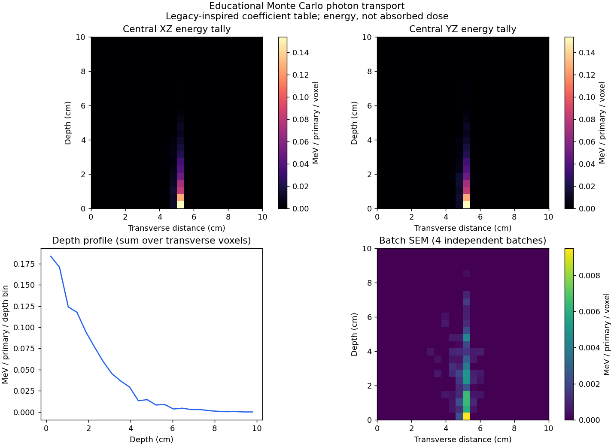
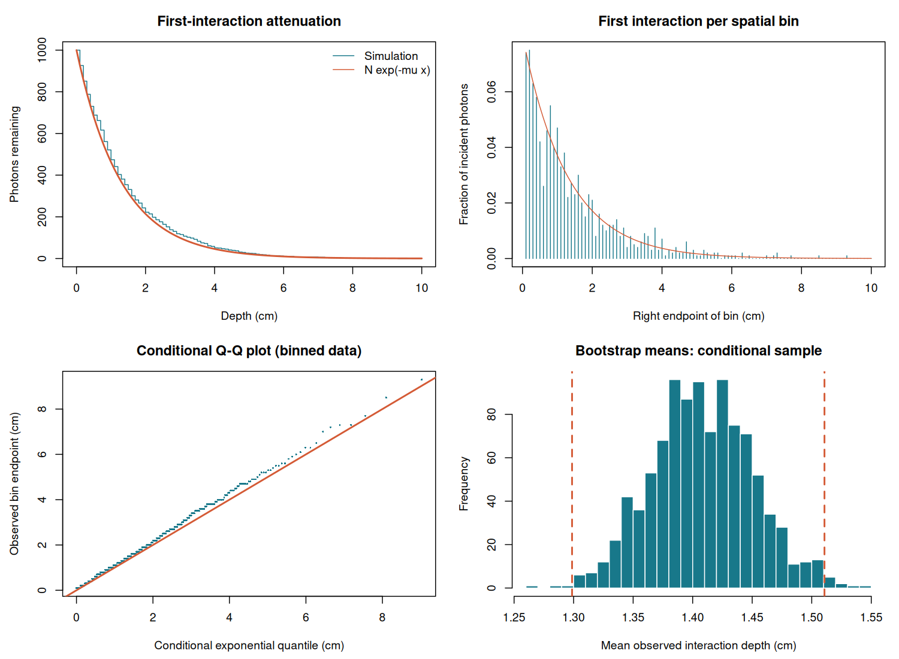

# Computational Statistics & Stochastic Processes

[](https://github.com/jorge-barb-pereira/computational-statistics-stochastic-processes/actions/workflows/scientific-checks.yml)

An academic programming portfolio exploring photon attenuation, bootstrap inference and Monte Carlo transport with **R and Python**. It includes historical coursework and a maintained edition with reproducible examples, numerical checks and documented model assumptions.

**Original R work:** November 2023, supported by source timestamps and the final script's `20231115` seed. The original Python notebook's development date could not be established. **Maintained edition:** October 2026. See [provenance](docs/PROVENANCE.md) for the evidence and its limits.

| Study | What it demonstrates | Maintained implementation |
| --- | --- | --- |
| First-interaction attenuation | Bernoulli/binomial simulation, exponential survival, conditional Q-Q plots | Base R; exact per-step probability and explicit transmitted count |
| Bootstrap inference | Basic confidence intervals for mean, median and 95th percentile | Resampling observed, binned interaction depths; clearly defined conditional target |
| Three-dimensional photon transport | Exponential free paths, photoelectric absorption, Compton scattering | Python package with normalized directions, bounded demo and energy ledger |
| Monte Carlo uncertainty | Independent batches and standard error of the mean | Streaming voxelwise statistics without retaining all history grids |

## Python quick start

Requires Python 3.11 or newer. From the repository directory:

```bash
python -m venv .venv
# Linux/macOS: source .venv/bin/activate
# Windows PowerShell: .venv\Scripts\Activate.ps1
python -m pip install -e .
python -m stochastic_photons --histories 4 --photons 300 --grid-size 24
python -m unittest discover -s tests -v
python tools/audit_repository.py
```

The command writes a PNG, a compressed NumPy archive and a JSON energy ledger to `output/python/`. Seeds reproduce runs within the same numerical environment; exact cross-version random streams are not promised. For a water-like legacy table, add `--material legacy-water`. Run `python -m stochastic_photons --help` for options.



The maintained demo uses one central, forward beam. The original notebook's multi-source experiments remain in the historical directory. The small [walkthrough notebook](notebooks/transport_demo.ipynb) uses the maintained package; an optional Jupyter installation is required to open it interactively. Its code is also checked by `python tools/check_demo_notebook.py`.

## R quick start

Requires R 4.3 or newer; the maintained code uses only base R. Run from the repository directory:

```bash
Rscript tests/test_r.R
Rscript scripts/run_r_demo.R
```

Outputs in `output/r/` include an attenuation figure, a survival profile and bootstrap interval CSV. The default model simulates 1,000 incident photons, an illustrative attenuation coefficient of 0.771 cm^-1, a 10 cm slab and 0.1 cm bins. Historical scripts require `ggplot2` separately.



## Model scope

These are educational stochastic models. The legacy material coefficients have no verified external provenance. Transport includes photoelectric absorption and free-electron Compton scattering, linear interpolation within the supplied table, and a local energy-deposition cutoff. It omits coherent scattering, electron tracking, fluorescence and detailed detector response. Deposited **energy** is reported in MeV; no mass conversion to absorbed dose is performed.

The R bootstrap describes interaction depths **conditioned on an interaction inside the slab**. Transmitted photons are counted but excluded from that sample. Binned event locations are recorded at bin endpoints. These intervals do not estimate the unrestricted exponential free-path distribution. See [model definitions and references](docs/MODELS.md).

## Repository map

```text
R/                    Maintained attenuation and bootstrap functions
src/stochastic_photons/ Maintained transport package and CLI
scripts/              R demonstration
notebooks/            Small Python walkthrough, without stored output
historical/           Four original R files, cleaned original notebook, hashes
tests/                Python and R numerical checks
tools/                Historical import, integrity audit, notebook verification
docs/                 Review, model definitions, provenance, validation
assets/               Generated previews
```

The historical notebook retains all **19 code cells**, with their sources unchanged. Its large embedded outputs and execution metadata were removed, reducing the original 75 MB file to a source-only archive. Some historical cells require substantial memory and contain known defects; use the maintained example first.

Read the [code review](docs/REVIEW.md), [validation record](docs/VALIDATION.md) and [attribution notice](THIRD_PARTY_NOTICES.md). Reports, slides, ZIP archives and notebook checkpoints are excluded. New interfaces and documentation are in English; historical sources retain their original text. Contributions should preserve provenance and include numerical evidence for model changes; see [contributing](CONTRIBUTING.md).
