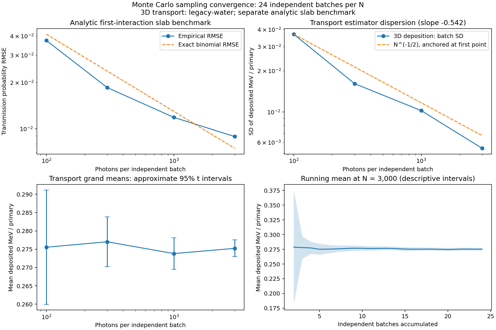
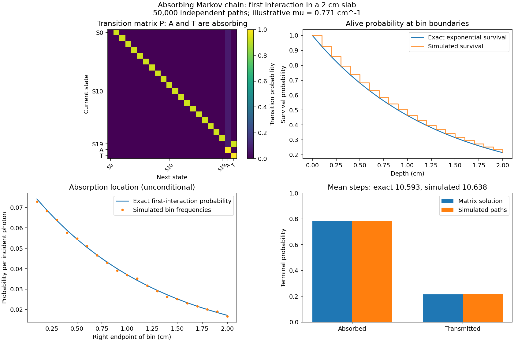

# Convergence and absorbing Markov-chain studies

These studies ask two specific questions:

1. Does the sampling dispersion of a transport energy estimator decrease approximately as N^-1/2 as photons per independent batch increase?
2. Does Monte Carlo first-interaction slab transport agree with exact absorbing-chain probabilities and mean termination time?

They assess sampling behavior and a simplified stochastic model. They do not validate the legacy material tables or establish medical dose accuracy.

## Reproduce

Install the package from the repository directory with `python -m pip install -e .`, then run:

```bash
python -m stochastic_photons.studies
# A small integration check, not the published experiment:
python -m stochastic_photons.studies --quick --output output/studies-quick
```

The full defaults use root seed 20261018, legacy-water, 12 voxels per axis, a 10 cm cube and 24 independent batches at each of N = 100, 300, 1,000 and 3,000. This totals **105,600 transport primaries**. Each setting and each batch receive distinct spawned random streams using [NumPy SeedSequence](https://numpy.org/doc/stable/reference/random/parallel.html). Photon counts below 1,000 are deliberate comparison points; the normal transport CLI retains its 1,000-photon default.

Generated files include `convergence.csv`, individual `transport_batches.csv`, run metadata, the Markov transition matrix, a Markov summary and two figures. Output stays in `output/studies/`; selected published results live in `results/` and previews in `assets/`. The command supports another material, seed or replicate count. A different run can give different empirical slopes and coverage fractions.

## Convergence design

For full 3D transport, every independent batch records deposited and escaped MeV per primary and checks the energy ledger. Any unresolved residual aborts the study. For each N, the sample standard deviation across 24 batch estimates measures dispersion of an N-photon estimator. Its expected asymptotic scaling is N^-1/2 for independent finite-variance photon scores. The plotted reference is anchored at the smallest-N empirical SD; it is not an independently known variance.

The reported log-log slope is a descriptive fit to four noisy SD estimates. It is not a hypothesis test or proof of asymptotic convergence. The grand mean's standard error is batch SD divided by sqrt(B), and its approximate 95% Student-t interval uses B-1 degrees of freedom. Approximate normality of batch means is assumed. The running-mean intervals at the largest N are descriptive, correlated across prefixes and not simultaneous confidence bands or an optional-stopping rule. See the [SciPy Student-t distribution](https://docs.scipy.org/doc/scipy/reference/generated/scipy.stats.t.html) used for the critical values.

A **separate analytic benchmark** uses uncollided first-interaction slab transmission with mu = 0.771 cm^-1 and length 2 cm. Its terminal count is sampled directly from Binomial(N,p), where p = exp(-mu L). The true per-batch estimator RMSE is sqrt(p(1-p)/N). Empirical RMSE is computed across the independent replicates, using that exact p rather than a noisy high-N reference. This tests the benchmark's sampling behavior, not the scattering transport engine. Wilson 95% interval coverage is recorded, but 24 trials give a noisy coverage estimate and do not establish nominal coverage.

The full-transport figure addresses global deposited energy. It makes no assertion that every voxel or tail region has converged. Spatial resolution, cutoff sensitivity, physical bias and external transport benchmarking remain separate questions. Deposition and escaped energy sum to the fixed source energy, so those two aggregate scores are not independent observables.



## Exact absorbing Markov chain

The formal finite chain uses the same first-interaction assumptions as the R attenuation study. It is a distinct model from the Python scattering simulation: a first interaction terminates the path. Its absorbing state A means a recorded first interaction, treated as absorption in this simplified model; it does not claim that every real photon interaction is photoelectric absorption.

For K spatial bins, transient state S_i means the photon is alive at the left boundary of bin i. The terminal states are A (absorbed/first interaction) and T (transmitted). With width delta_i:

```text
q_i = exp(-mu * delta_i)
P(S_i, A) = 1 - q_i
P(S_i, S_(i+1)) = q_i          for i < K-1
P(S_(K-1), T) = q_(K-1)
P(A,A) = P(T,T) = 1
```

With transient block Q and transient-to-terminal block R, the fundamental matrix is F = (I-Q)^-1. Terminal probabilities are F R and expected transitions until termination are F 1. The implementation uses a linear solve rather than explicit inversion. It verifies the starting-state transmission against exp(-mu L), the duration against the sum of survival probabilities at bin starts, and first-interaction bin probabilities against exp(-mu x_i)(1-exp(-mu delta_i)).

These finite-chain identities follow the absorbing-chain treatment in Grinstead and Snell, [Introduction to Probability, section 11.2](https://math.dartmouth.edu/~prob/prob/prob.pdf). No textbook source code is bundled.

The default is a 2 cm slab with 0.1 cm bins: **20 transient states and two absorbing states**. Fifty thousand independent paths are simulated with seed 20261019. The summary reports exact and empirical transmission, a Wilson 99% interval, mean termination steps and matrix row-sum errors. This is an absorbing transport chain, not MCMC: burn-in, mixing diagnostics and posterior effective sample sizes do not apply. It has two absorbing classes rather than a unique equilibrium distribution.

The complete state for 3D transport would include position, direction and energy, plus a terminal label. Binning energy alone generally loses the Markov property because escape and future deposition depend on position and direction. Consequently, this study does not present a fitted energy-bin transition matrix as an exact description of 3D transport. The interactions behind the scattering model are described in [OpenMC's photon methods](https://docs.openmc.org/en/stable/methods/photon_physics.html).



## Validation

Tests cover stochastic row sums, absorbing classes, closed-form terminal probabilities, mean first-passage duration, a partial final bin, simulated terminal counts and duration within broad analytic sampling tolerances, Wilson reference values, independent seeded design and the analytic N^-1/2 RMSE relationship. CI executes a small end-to-end study on both supported Python versions. Published results come from the full design, not the quick check.
